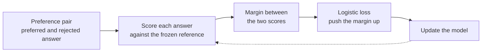

> [!abstract]
> Teach a chatbot what people prefer by training it directly on pairs of answers, with no separate scoring model and no reinforcement learning.

## Overview

### Setting

Language models know a lot but do not know which of their answers people like. The usual fix is to collect people's choices between two answers to the same prompt and steer the model toward the chosen kind of answer: more helpful, less rude, a better summary. Each choice is cheap for a person to make, which is why preferences are used in place of writing ideal answers by hand.

### Motivation

The standard recipe ([[Reinforcement learning from human feedback]], RLHF) trains three things in sequence: a reward model that scores answers, then the language model optimised with reinforcement learning to earn high scores, while a penalty keeps it close to where it started. That reinforcement step samples new answers in a loop and is slow and fragile. The paper's key insight: the reward model and the language model are two views of one object. If the model's probabilities already define a reward, the scoring network can be dropped and the preference data can train the language model directly.

### Method

1. **Take** a prompt with a preferred answer and a rejected answer from the dataset.
2. **Score** each answer by how much more likely the model now makes it than a frozen copy of the starting model does.
3. **Compare** the two scores: the preferred answer should win by a margin.
4. **Update** the model with a plain classification loss on that margin, then repeat over the data.

Only the first step needs data; nothing is sampled from the model during training. The reference copy stays fixed, so the model cannot drift far from it.

### Why it works

- **The model as its own reward** ([[Implicit reward]]): the score is a log-ratio against the reference, so the language model is the reward model. This removes the scoring network and the reinforcement loop.
- **The hard normaliser cancels** ([[Bradley-Terry model]]): the reward has an intractable constant, but it is the same for both answers to one prompt, so it drops out of the comparison.
- **Weighting by how wrong the ranking is:** a pair the model already ranks correctly gets little push, and a pair it ranks wrongly gets a big one. A naive version that just raises the preferred answer's probability and lowers the rejected one degenerates; this weighting is what prevents it.
- **One strength knob:** a single number sets how far the model may move from the reference, the same trade-off RLHF makes between reward and staying close to the starting model.

### Applications and results

| Domain | Task in everyday words | Outcome |
|---|---|---|
| Sentiment | Write movie reviews that a classifier scores as positive, without drifting into gibberish | Better reward for the same drift than PPO, even PPO given the true reward |
| Summarisation | Short summaries of Reddit posts | Summaries people preferred to PPO's in a direct comparison, and steadier when sampling is made more random |
| Dialogue | Helpful, harmless single-turn chat | The only efficient method that beat the dataset's chosen replies; matched sampling many answers and keeping the best |
| News summaries | Models trained on Reddit, tested on news | Still ahead of PPO, a modest out-of-distribution check |

### Evidence

- **Small models:** the largest tested model has a few billion parameters; behaviour at frontier scale is not shown.
- **Light PPO baselines:** PPO was run off the shelf or lightly tuned, and dialogue has no PPO run at all.
- **Judge-dependent scores:** win rates come from GPT-4 comparing answers to a reference; the judging prompt matters, although GPT-4 agreed with people about as often as people agree with each other.
- **Open questions left by the paper:** over-optimisation (the model gaming its preference signal) and behaviour far from the training data.
- **Offline by design:** it learns only from the pairs it was given, so it says nothing about answers it never saw.

### Novelty

- **vs the RLHF pipeline** ([[Training language models to follow instructions with human feedback]]): same objective, no reward model and no reinforcement loop.
- **vs [[Learning to summarize from human feedback]]:** same kind of summary preference data, simpler training.
- **vs the unlikelihood baseline:** the same pair data pushed down without the weighting degenerates; the weighting is the fix.
- **vs contextual dueling bandits:** those learn from preferences given online; DPO learns from a fixed batch of labelled pairs.

### Concepts

- **[[Bradley-Terry model]]:** a way to turn two scores into the chance that one answer beats the other, through the difference of the scores.
- **[[KL-regularised reward maximisation]]:** the RLHF goal of earning reward while staying close to the starting model, measured by a divergence.
- **[[Implicit reward]]:** a reward read off the model's own probabilities, not learned by a separate network.

## Questions

- Why does the comparison need only the difference of two scores, and what would break if the two answers came from different prompts?
- What exactly does the weighting change, compared with simply raising the preferred answer's probability?
- What is the model learning from if the chosen and rejected answers are almost always clearly different?
- How would the implicit reward compare with a trained reward model when used to rank new answers?

## Follow-ups

**Read**:
- [[A General Theoretical Paradigm to Understand Learning from Human Preferences|IPO]]: the theoretical critique; DPO can over-commit when preferences are near-deterministic.
- [[KTO. Model Alignment as Prospect Theoretic Optimization|KTO]]: needs only a good or bad label per answer, not pairs.
- [[Unpacking DPO and PPO. Disentangling Best Practices for Learning from Preference Feedback|Unpacking DPO and PPO]]: a matched comparison where PPO edges ahead at much higher cost.
- [[Preference Fine-Tuning of LLMs Should Leverage Suboptimal, On-Policy Data]]: when training on fixed pairs is enough, and when fresh samples are needed.

**Try**:
- Write the loss on a toy model that picks one of three answers, with a frozen copy as reference, and watch the preferred answer's probability rise relative to the reference.
