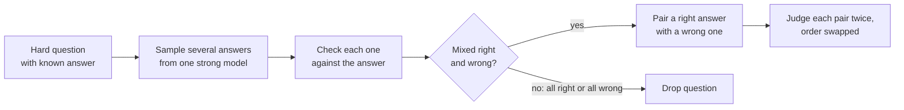

> [!abstract]
> A test of whether an AI judge can tell a right answer from a subtly wrong one, when the answers are too hard for people to check quickly.

## Overview

### Setting

Judging answers to hard questions: a physics calculation, a competition math problem, a programming contest task. Here the judge's job is to pick the answer that is actually correct, not the one that reads better. Because each question has a checkable answer, the right label is known for every pair.

### Motivation

Judges are usually validated by how often they agree with crowd preferences, as in [[Judging LLM-as-a-Judge with MT-Bench and Chatbot Arena]]. That target breaks down on hard tasks, because crowd workers also get them wrong and tend to favour answers that look plausible or are longer.

The paper's fix is an ordering of criteria: first, does the answer follow the instruction; second, is it factually and logically correct; third, does its style suit people. Style only matters once the first two are settled. For hard problems the second criterion is the one that matters, and it is the one crowds cannot judge reliably.

### Method

The benchmark is built from existing hard datasets with automatic checkers:

The key step is the filter. A question where the model gives both right and wrong answers is one it cannot reliably solve, so its wrong answers are the subtle ones a judge is likely to miss.

**Sampling from one model** removes style differences between answers and stops any judge from favouring its own family's writing.

**Dropping format mismatches**: a checker can mark a correct answer wrong because of formatting. An LLM grader cross-checks the checker, and disagreements are removed so that no pair can be solved by spotting formatting.

### Why it works

- **One generator for both sides** ([[Self-preference bias]]): both answers in a pair come from the same model, so a judge cannot win by recognising a family's style.
- **Filter on mixed results**: keeps only questions where wrong answers are plausible. Easy pairs would not separate judges.
- **Judge each pair twice, swapped**: removes position preference ([[Positional bias in judges]]). A verdict counts only if both orders agree on the right answer, so a judge that guesses scores below chance.

### Applications and results

| Domain | Task, in plain words | Outcome |
|---|---|---|
| Knowledge | Multiple-choice expert questions across many fields | Judges near chance; best prompted judge about 51–57% |
| Reasoning | Logic puzzles and multi-step problems | Only reasoning models pass 70% |
| Math | Competition problems | Judges do better here than solving the problem |
| Coding | Contest programming tasks | Judges do worse here than solving the problem |

### Evidence

- **Clear gap to older benchmarks:** the strongest of five models scores 64% here, the lowest across four earlier judge benchmarks.
- **Reasoning models lead:** the best scores come from models that think before answering, and more thinking gives more accuracy.
- **Judging tracks solving:** a model's judge accuracy is close to its own solving accuracy, except in math and coding.
- **Thin on the generator side:** only one generator for the main results, and a single ablation with another model.
- **No human baseline:** the paper never shows how well careful people do on these pairs.
- **Small:** 350 pairs, only 42 of them coding, so one item moves a coding score by about 2 points.

### Novelty

- **vs [[Judging LLM-as-a-Judge with MT-Bench and Chatbot Arena]]:** judged against objective correctness, not crowd agreement.
- **vs [[LLMBar]]:** tests correctness and reasoning, not only instruction following.
- **vs [[RewardBench. Evaluating Reward Models for Language Modeling]]:** its math and coding subsets are saturated (up to 97%); these are not.
- **Broader point:** the paper argues that weak judges become the bottleneck for scaling test-time compute.

### Concepts

- [[LLM-as-a-judge]]: a model asked to pick or score another model's answer.
- [[Reward model]]: a scorer trained on preferences, giving one number per answer.
- [[Positional bias in judges]]: favouring whichever answer sits in a given slot.
- [[Self-preference bias]]: judges favouring answers written by their own model.

## Questions

- Why does one generator for both answers make the pairs harder, not just fairer?
- What would a 50% judge be doing, given that a pair always has one right answer?
- Does the ranking survive if the pairs come from a different model family?
- Is the filter testing judging, or the generator's instability on that question?

## Follow-ups

**Read**:
- [[Judging LLM-as-a-Judge with MT-Bench and Chatbot Arena]]: the human-agreement benchmark this one argues against.
- [[RewardBench. Evaluating Reward Models for Language Modeling]]: the reward-model benchmark it compares to.
- [[LLMBar]]: the instruction-following judge benchmark it builds on.
- [[Reliability without Validity. A Systematic, Large-Scale Evaluation of LLM-as-a-Judge Models]]: a later audit of judges across benchmarks.

**Try**:
- Read five pairs from the GitHub repo and pick the correct answer for each before looking at the labels. Note which ones you got wrong and why.
