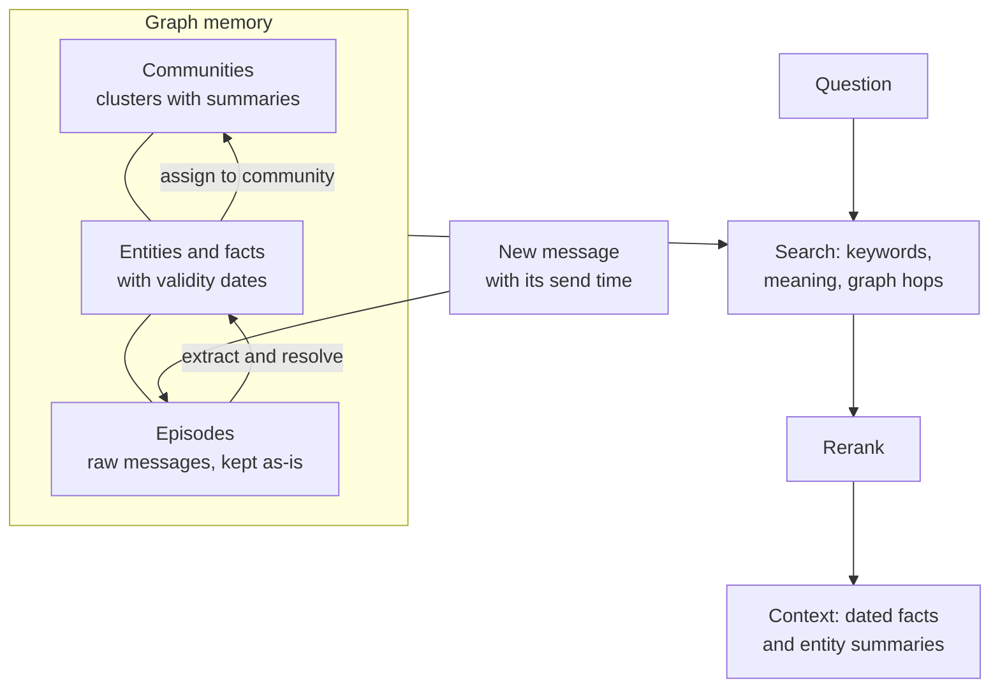

> [!abstract]
> A chat agent's memory as a graph of facts that each carry dates, so that a changed fact closes its old version instead of overwriting it.

## Overview

### Setting

A chat agent has to remember a user across many sessions: preferences, plans, a job change, a move. The usual approach stores old text chunks and fetches the ones that look similar to the question. That works until facts change. After "I live in Boston" and later "I moved to Berlin", both sentences look relevant, and nothing says which one is current or when each was true. Success here means answering correctly about the user now and about how things changed, fast enough for a product.

### Motivation

Chunk retrieval treats memory as a static pile of text. Memory systems such as [[MemGPT]] let the model page text in and out of its own context, which pushes the bookkeeping onto the model. Neither records how facts evolve over time.

The key insight: keep the memory as a knowledge graph, with entities as nodes and relationships as edges, and give each relationship a validity period. A new fact then closes the old one's period, and the history stays readable.

### Architecture

Messages go in as raw episodes. Facts and entities are extracted from them, and related entities are grouped into communities. A question triggers three kinds of search over this store, then a re-ranking step builds the text the chat model reads.

### Recipe

- **Keep the raw messages.** Every fact points back to the message it came from, so nothing is lost and facts can be quoted.
- **Match entities by meaning, then decide.** A new mention is compared with existing entities by embedding and text search, and an LLM decides whether they are the same.
- **Resolve dates against the send time.** "Next Thursday" becomes a real date.
- **Invalidate, don't delete.** When a new fact contradicts an old one, the old fact's end date is set. The newer information wins, and the history stays.
- **Update communities cheaply.** A new entity joins the community most of its neighbours belong to. A full recomputation is run only now and then.

### Results

| Benchmark | Task in everyday words | Outcome |
|---|---|---|
| Deep Memory Retrieval | Answer one question from about 60 past messages | Level with feeding the whole chat to the model; the authors call the benchmark too easy |
| LongMemEval | Answer questions about long histories (about 115k tokens), including preferences and changes | 63.8% vs 55.4% for full history, same model, with about 1.6k tokens of context |
| LongMemEval, latency | Same questions, time to answer | About 3 s vs about 30 s |

The gains concentrate on preference, temporal and multi-session questions. One type gets worse: questions about what the assistant itself said (p. 7).

### Evidence

- **Vendor-run:** all authors work at Zep AI, and the tests ran on its hosted service.
- **Benchmarks only:** two public benchmarks, with no real users and no deployment data.
- **No ablations:** nothing shows what the time tracking or the communities add on their own.
- **Thin baselines:** MemGPT could not be run on LongMemEval, so full history is the only comparison there.

### Novelty

- **vs [[MemGPT]]:** an outside graph is updated automatically and keeps dated facts, instead of the model managing its own memory.
- **vs [[GraphRAG]]:** the same community idea, but built per message for one user's history, and updated incrementally with label propagation instead of Leiden.
- **vs [[HippoRAG]]:** a graph memory with no time dimension; here every fact has a validity period.
- The two clocks (when a fact was true, and when the system learned it) are the paper's own addition.

### Concepts

- [[Knowledge graph]]: entities as nodes, relationships as labelled edges.
- [[Bitemporal data model]]: two timelines, when a fact held and when the database recorded it.
- [[Label propagation]]: a community method where each node adopts the most common label among its neighbours.

## Questions

- What exactly gets closed when a new fact arrives, and how is a contradiction detected?
- Why keep raw messages next to the extracted facts?
- How far do incremental community updates drift before a refresh is needed?
- Would a long-context model answer change-over-time questions as well?

## Follow-ups

**Read**:
- [[MemGPT]]: the baseline and the closest alternative design, where the model manages memory.
- [[Mem0]]: a later production memory system with a graph variant, tested against Zep.
- [[LongMemEval]]: the main benchmark; its question types structure the results.
- [[GraphRAG]]: the source of the community idea.

**Try**:
- Write six chat lines where one fact changes, then fill a table of facts with start and end dates by hand. Ask which city the user lives in "now".
