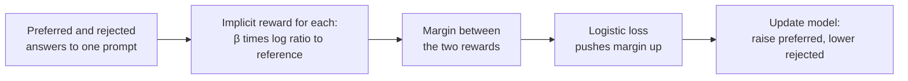

> [!abstract]
> Trains a language model on pairs of answers marked "this one is better" directly, with one simple loss and no separate scoring model or reinforcement learning.

## Overview

### Setting

Steering a language model toward what people find helpful or safe, using pairs of answers to the same prompt where a person picked the better one. The goal is to make the model prefer the kind of answer the person chose, without drifting far from the model it started with.

### Motivation

The usual recipe, [[RLHF]], first trains a separate model to score answers, then uses reinforcement learning to make the language model maximise that score while staying close to where it began. That is several models and a sampling loop, and RL on a large language model is hard to keep stable.

The key insight: the goal "maximise reward but stay close to the starting model" has a known exact answer. That answer lets you express the reward in terms of the language model itself. Then "which answer is better" becomes a plain classification problem on the model, with no reward model and no RL.

### Method

1. **Start** from a model already tuned on good examples. This frozen copy is the reference.
2. **Take** prompts, each with a preferred and a rejected answer. Nothing new is sampled.
3. **Score** each answer by how much more likely the model makes it than the reference does. This is the implicit reward.
4. **Push** the preferred answer's score above the rejected one's with one logistic loss.

$$\mathcal{L}_{\text{DPO}} = -\mathbb{E}_{(x,\,y_w,\,y_l)}\left[\log\sigma\!\left(\beta\log\frac{\pi_\theta(y_w\mid x)}{\pi_{\text{ref}}(y_w\mid x)} - \beta\log\frac{\pi_\theta(y_l\mid x)}{\pi_{\text{ref}}(y_l\mid x)}\right)\right]$$

Here $x$ is the prompt, $y_w$ the preferred and $y_l$ the rejected answer, $\pi_\theta$ the model being trained, $\pi_{\text{ref}}$ the frozen reference, $\sigma$ the logistic function, and $\beta$ how strongly the model is kept near the reference. In words: the loss falls when the model's log-ratio to the reference is higher for the preferred answer than for the rejected one.

The reward is never built as a separate network; it is read off the model's own probabilities. The loop closes because the same model is both the policy and the reward.

### Why it works

- **[[Implicit reward]] as a log ratio:** writing the reward as a log ratio to the reference makes the unknown normalising constant cancel when two answers to one prompt are compared, so the reward model can go.
- **Staying close, built in:** the penalty for drifting from the reference is the reference term inside the loss, so no sampling is needed to keep the model near its start.
- **Weight by how wrong it is:** each pair's gradient is scaled by how badly the implicit reward currently orders it. Pairs already ordered correctly stop contributing. Without this weight, the paper's naive baseline degenerates.
- **Fixed data, one pass of ordinary training:** it learns from a dataset collected once, so there is no generate-score-update loop.

### Applications and results

| Domain | The task, in plain words | Outcome |
|---|---|---|
| Movie reviews | Continue a review in a positive tone | Better reward-versus-drift trade-off than PPO, even PPO given the true reward |
| Forum summaries | Summarise a Reddit post | Matched or beat PPO's best setting; less sensitive to sampling temperature |
| Helpful dialogue | Answer a person's question | The only cheap method that beat the human-chosen replies; close to best-of-128 sampling |
| News summaries | Same summariser on new articles | Still ahead of the PPO model |

### Evidence

- **Controlled reward:** the movie-review task has a true reward (a classifier), so the trade-off can be measured exactly.
- **Judged by GPT-4:** the summary and dialogue numbers are GPT-4 win rates. A small human study agreed with GPT-4 about as often as humans agree with each other.
- **Thin baselines:** PPO is off-the-shelf or lightly tuned, and the dialogue task has no PPO run at all; best-of-128 stands in for it.
- **Small models, single runs:** models are up to 6B parameters, and the authors barely tuned $\beta$.
- **Open:** over-optimisation and out-of-distribution behaviour are left for future work.

### Novelty

- vs [[Training language models to follow instructions with human feedback|InstructGPT]]: the same kind of preference data and the same objective, with no reward model and no PPO.
- vs learning from preferences in bandits and preference-based RL: those estimate a reward first and then optimise it; this optimises the policy directly.
- vs prior reward-then-RL work on summaries: the same preference data, minus the RL step.

### Concepts

- [[Bradley-Terry model]]: the chance that answer A beats B is $\sigma(r_A - r_B)$, where each $r$ is a hidden score.
- [[Implicit reward]]: the reward defined by a policy relative to its reference, $\beta\log\frac{\pi_\theta}{\pi_{\text{ref}}}$.

## Questions

- Why does the normalising constant vanish when comparing two answers to one prompt?
- What exactly does the per-pair weight stop from happening?
- Where would learning only from a fixed dataset run out of road?
- How does this differ from best-of-N sampling against the same learned reward?

## Follow-ups

**Read**

- [[A General Theoretical Paradigm to Understand Learning from Human Preferences|IPO]]: shows DPO can overfit when preferences are nearly deterministic.
- [[Is DPO Superior to PPO for LLM Alignment. A Comprehensive Study|Is DPO Superior to PPO]]: the main pushback, with a tuned PPO ahead on hard tasks.
- [[Preference Fine-Tuning of LLMs Should Leverage Suboptimal, On-Policy Data|On-policy preference data]]: when offline DPO is enough and when it is not.

**Try**

- Write the DPO loss for one pair in a few lines of PyTorch with made-up log-probabilities, then raise the preferred answer's log-probability and watch the loss fall.
