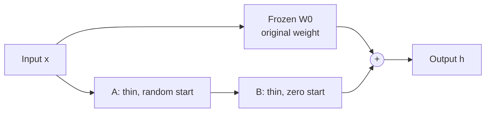

> [!abstract]
> Freeze a big model and train a thin add-on per layer, so each task costs megabytes, not a full copy.

## Overview

### Setting

Adapting one large pretrained language model to many tasks, such as turning questions into SQL, summarising chats or classifying sentences. The problem is storage: a fully fine-tuned copy per task of a 175-billion-parameter model is hundreds of gigabytes to deploy.

### Motivation

Full fine-tuning copies every parameter. The usual fixes trade quality for speed. [[Parameter-Efficient Transfer Learning for NLP|Adapters]] add small layers that run one after another, which slows a single-input request. Prefix methods are hard to optimise and use up part of the context window. The key insight: **the change a task needs may be low-rank**, so a pair of thin matrices can carry it, and that pair can be folded back into the original weights.

### Method

1. **Freeze** the pretrained weight matrix $W_0$ of each attention projection.
2. **Add** two thin matrices beside it, $B$ and $A$, with $B$ starting at zero.
3. **Run** the input through both paths and sum the outputs: $h = W_0x + BAx$.
4. **Train** only $A$ and $B$ on the task's loss.
5. **Merge** $W_0 + BA$ for serving, or keep the pair separate to swap tasks quickly.

At the start $B$ is zero, so the sum is just the original model's output. Training moves only the side path.

### Why it works

- **Low-rank update** ([[Matrix rank]]): the task's change lives in a few directions, so the rank $r$ can be far below the matrix size. The paper argues a rank of one or two suffices even at the full width of GPT-3's layers.
- **Zero start**: $B = 0$ means training begins exactly at the pretrained model, so nothing is disturbed at step one.
- **Merge after training**: the product $BA$ folds into $W_0$, so inference runs the same layers as before. This is the answer to adapters' extra latency.
- **Frozen base, small optimizer state**: there are no gradients or Adam statistics for the big matrices, so training memory drops, by up to two-thirds when the rank is small.
- **Scaling by $\alpha / r$**: the update is scaled so that changing the rank rarely needs a new learning rate. The paper fixes $\alpha$ to the first rank it tried.

### Applications and results

| Domain | Task, in plain words | Outcome |
|---|---|---|
| Language understanding (GLUE, RoBERTa and DeBERTa) | sentence classification and entailment | matched full fine-tuning with a fraction of the trainable weights |
| Data-to-text (E2E, GPT-2) | turning restaurant attributes into sentences | matched or beat full fine-tuning and prefix methods |
| Large model (GPT-3 175B) | text to SQL, entailment, dialogue summaries | on par with full fine-tuning, better on two of three tasks |

### Evidence

- **Several benchmarks, four model families**: GLUE, E2E, WikiSQL, MNLI and SAMSum, on RoBERTa, DeBERTa, GPT-2 and GPT-3.
- **Baselines run by the authors**: full fine-tuning, adapters and prefix methods.
- **Ablations on two tasks**: which matrices to adapt and at which rank, studied mostly on WikiSQL and MNLI.
- **Attention only**: MLP layers, normalisation and biases were not adapted; the paper leaves them to future work.
- **Rank caveat**: the paper warns that rank one may not hold for tasks far from pretraining, such as a new language.
- **Later check (not from the paper)**: [[LoRA Learns Less and Forgets Less]] finds LoRA trails full fine-tuning on code and maths.

### Novelty

- vs [[Parameter-Efficient Transfer Learning for NLP|adapters]]: the same bottleneck idea, but the update merges into the weights, so inference costs nothing extra.
- vs [[Prefix tuning]]: LoRA changes the weights rather than adding prompt vectors, so no context length is spent.
- vs the [[Intrinsic dimension]] work (Aghajanyan et al.): that work showed a model can learn in a small random subspace; LoRA applies the low-dimension idea to the weight change itself.

### Concepts

- [[Parameter-efficient fine-tuning]]: adapting a model by training a tiny share of its weights.
- [[Intrinsic dimension]]: the number of directions a task really needs, far below the parameter count.
- [[Matrix rank]]: the number of independent directions a matrix uses; $BA$ has rank at most $r$.
- [[Weight merging]]: folding $BA$ into $W_0$ so the model runs as one matrix again.

## Questions

1. Why should a task's weight change be low-rank at all?
2. Why does $B$ start at zero rather than random?
3. What breaks when one batch needs two different adapters?
4. Where would a rank-one update fail, and how would you tell?
5. Does the merge trick still hold if the adapter sits on the MLP too?

## Follow-ups

**Read**:
- [[LoRA Learns Less and Forgets Less]]: the closest later check, on code and maths (in library).
- [[QLoRA]]: the same adapter on a quantised base model (in library).
- [[DoRA]]: splits each weight into magnitude and direction, and beats LoRA at equal rank (in library).
- [[Parameter-Efficient Transfer Learning for NLP|Houlsby adapters]]: the baseline this paper argues against (in library).

**Try**:
- Write a ten-line PyTorch module: a frozen linear layer plus $BA$ with $B$ at zero, and check that its output matches the original before any training.
