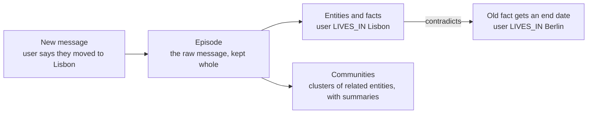

> [!abstract]
> Agent memory as a graph of facts, each stamped with when it held, so old facts are retired, not erased.

## Overview

### Setting

**Setting:** an agent that talks with one person over months, where facts change. Success means answering from what is true now while still knowing what used to be true.

### Architecture

The memory is a graph in three layers. Each new message enters as a raw **episode** and is kept whole, so any fact can be traced back to what was said. Entities and facts are pulled out of it and merged into the graph. **Communities** group related entities and carry a summary, for questions about a whole topic.

The Lisbon and Berlin facts are our example, not the paper's. Notice that the old fact is kept, with an end date, rather than deleted.

### Recipe

The choices the report says mattered:

- **Keep the raw message** next to what was extracted from it, so every fact can be checked against its source.
- **Read each message with the last four messages** as context, so extraction sees who "she" or "it" refers to.
- **Write with fixed database queries**, not queries the LLM writes, so the store's format stays consistent.
- **Check new facts against related old ones.** On a contradiction, the old fact's end time becomes the new fact's start time: $t^{\text{old}}_{\text{invalid}} \leftarrow t^{\text{new}}_{\text{valid}}$. Newer information always wins.
- **Merge duplicate facts only between the same two entities**, which keeps the check cheap and stops look-alike facts about different people from merging.
- **Cluster with label propagation**, not Leiden: a new entity joins its neighbours' cluster without a full rerun, though the clusters still need a periodic refresh.
- **Retrieve in three steps:** search three ways (meaning, keywords, and a walk out from recent entities), rerank, then hand the model the facts with their date ranges and the entity summaries.

### Evidence

- **Vendor-run:** the authors ran their own hosted service.
- **Easy benchmark:** on the DMR benchmark, full context already scores about 98%, and the authors call DMR ambiguous and too easy. No error bars are given, so a gap of a fraction of a point (not from the paper: small gaps can be noise) says little.
- **Thin baselines:** on LongMemEval the only baseline is full context. MemGPT could not run on it, and no other memory system is compared.
- **No ablations:** many search, rerank and graph choices, none tested alone, so the reader cannot tell which part helps.
- **Uneven by question type:** the gains are largest on preference, temporal and multi-session questions. Single-session-assistant questions get worse.

### Results

| Benchmark | Task, in everyday words | Outcome |
|---|---|---|
| DMR | Answer one question about a five-session chat | Slightly ahead of full context and [[MemGPT]], by fractions of a point |
| LongMemEval | Answer questions over long chat histories | Higher accuracy than full context, with about 1.6k tokens of context instead of 115k, and roughly 90% lower latency |

### Novelty

- **vs [[MemGPT]]:** the model pages its own memory with function calls. Zep keeps memory in an outside graph and fetches context before the model answers.
- **vs [[GraphRAG]]:** borrows its community summaries, but grows the communities incrementally instead of rerunning.
- **vs [[AriGraph]]:** borrows its split between raw episodes and extracted facts, and adds time.
- **vs [[HippoRAG]]:** a graph over a changing conversation, not a fixed document set, and each fact records when it held.
- **The broader claim:** the paper argues that retrieval over static documents is not enough for memory that keeps changing.

### Concepts

- [[Temporal knowledge graph]]: facts as edges between entities, each with a time range.
- [[Bitemporal data model]]: two clocks, one for when a fact held in the world, one for when the system learned it.
- [[Label propagation]]: each node takes the most common label among its neighbours, which here groups entities into communities.

## Questions

- Which facts does a contradiction retire, and how does the graph decide which is newer?
- Why keep the raw messages when the extracted facts already exist?
- Would a vector store with timestamps answer the same "what was true then" questions?
- Where would the graph break: many entities, or facts that never contradict?

## Follow-ups

**Read:**
- [[MemGPT]]: the memory-as-operating-system baseline Zep measures itself against.
- [[Mem0]]: a later production memory system with a graph variant, compared against Zep.
- [[HippoRAG]]: graph memory over a fixed corpus, the contrast case for "no time".

**Try:**
- Make a toy by hand: store "Ana lives in Berlin", then add "Ana moved to Lisbon in 2026", and mark the first as ended. Ours, not from the paper.
