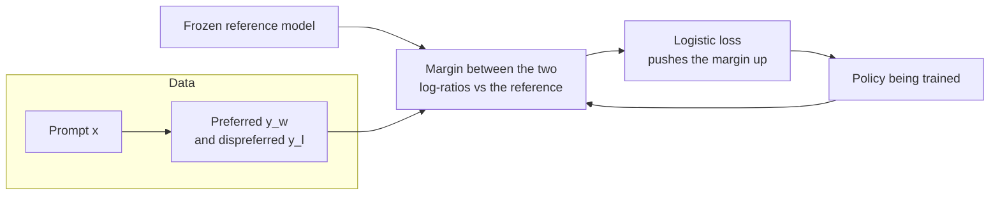

> [!abstract]
> Steer a language model toward answers people prefer by training it on pairs of answers, with no reward model and no reinforcement learning.

## Overview

### Setting

Steering a pretrained model toward answers people like, from a dataset where a person picked one of two answers. Success means the model's answers are preferred **and** it stays close to the model it started from, so it does not drift into odd text to game the preference.

### Motivation

The standard recipe, [[Reinforcement learning from human feedback]] (RLHF), has two stages. First, fit a separate reward model to the pairs. Second, run reinforcement learning (usually PPO) to make the model score highly under that reward, while a penalty keeps it near the starting model. This means several models in memory, and sampling from the model during training. It is slow and often unstable.

The key insight: the penalised objective has a closed-form optimum, and that optimum determines the reward. So the reward is a function of the model itself, and the preference data can train the model directly.

### Method

1. **Start** from a supervised model, the reference $\pi_{ref}$, frozen.
2. **Take** a pair: the preferred answer $y_w$ and the dispreferred $y_l$ to the same prompt $x$.
3. **Measure** each answer's log-ratio: how much more likely the trained model makes it than the reference does.
4. **Push** the preferred log-ratio up and the dispreferred one down, through a logistic loss.
5. **Repeat** over the dataset. The model is never sampled during training.

The loop is one model and one loss. The reference only supplies the baseline for each log-ratio. Nothing in the loop generates text.

### Why it works

- **Reward written as a log-ratio** ([[Implicit reward]]): the reward is $\beta\log\frac{\pi(y|x)}{\pi_{ref}(y|x)}$, so the policy is its own reward model and no second model is trained.
- **Reference anchor**: the reference term keeps the policy near its starting point, the same leash RLHF uses, now built into the loss.
- **Weight on each pair**: the gradient is scaled by how wrongly the current implicit reward orders the pair. Pairs already in the right order get little push. Without this weight, a plain "raise good, lower bad" rule collapses the model onto unlikely text.
- **Offline**: the preference pairs are fixed, so training is a supervised-style pass over data.

### Applications and results

| Domain | Task, in plain words | Outcome |
|---|---|---|
| Sentiment | Make movie reviews more positive while staying near the base model | Better reward-versus-drift trade-off than PPO |
| Summarisation | Short summaries of Reddit posts, judged against a human summary | Slightly ahead of PPO, and steadier across sampling temperature |
| Dialogue | Helpful, harmless single-turn answers | Only efficient method that beats the dataset's chosen answers; matches best-of-128 sampling |
| Out of distribution | News summaries, a different domain from training | Generalises better than PPO |

### Evidence

- **Narrow scale:** models up to 6B parameters, three tasks, one run per setting.
- **Judged by GPT-4 and people:** win rates against a reference, plus a human head-to-head where people preferred DPO's output to PPO's; GPT-4 agreed with people about as often as people agreed with each other.
- **Thin PPO baselines:** PPO was run off the shelf or lightly tuned, and not at all on dialogue, where best-of-N sampling stands in for it.
- **Open:** over-optimisation of the implicit reward and behaviour outside the training distribution are left for later work.

### Novelty

- vs [[Reinforcement learning from human feedback]] with PPO: same objective, but no reward model and no sampling in the loop.
- vs unlikelihood training: adds the per-pair weight, which is what stops degeneration.
- vs reward-model ranking (best-of-N at inference): trains the policy instead of reranking at test time.
- Broader trend: the paper argues that the field's RL step can be replaced by a classification loss over pairs.

### Concepts

- [[Bradley-Terry model]]: the usual model of which answer people prefer. Pick the answer whose reward is higher, with the probability $\sigma(r_w - r_l)$, a logistic function of the reward gap.
- [[KL-regularised reward maximisation]]: maximise reward minus $\beta\,\mathrm{KL}(\pi \,\|\, \pi_{ref})$. The divergence term is the leash to the starting model, and $\beta$ sets how tight it is.

## Questions

- Why does the unknown normalising constant of the reward cancel out of the loss?
- What does the per-pair weight prevent that a plain log-ratio objective allows?
- Where would the implicit reward break once the policy is pushed hard?
- How does training on fixed pairs differ from PPO's sampling of new answers?

## Follow-ups

**Read**:
- [[Training language models to follow instructions with human feedback|InstructGPT]]: the PPO-based RLHF pipeline DPO replaces.
- [[Is DPO Superior to PPO for LLM Alignment]]: a tuned PPO baseline changes the comparison.
- [[Preference Fine-Tuning of LLMs Should Leverage Suboptimal, On-Policy Data]]: when offline DPO is enough and when sampling is needed.

**Try**:
- Compute the loss by hand for one pair with made-up probabilities, then raise the preferred answer's probability and watch the loss fall.
