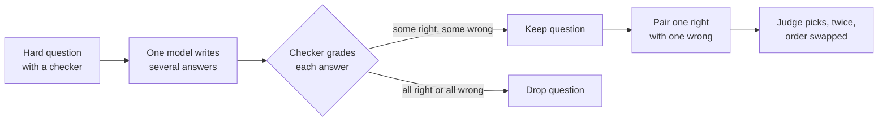

> [!abstract]
> A test for AI judges on pairs where one answer is right and one is wrong, built so that a judge cannot win by style.

## Overview

### Setting

Judges now grade, rank and train models, but they are usually checked by how often they agree with crowd workers. On hard questions (a proof, a physics answer, a coding task) crowd workers often get it wrong too, and they tend to prefer the answer that sounds more plausible or is longer. So agreement with them measures the wrong thing. The paper asks a narrower question: given a right answer and a wrong answer to a hard, checkable question, does the judge pick the right one?

### Construction

The trick is in how the pairs are made. Take a hard dataset that has a reference answer and an automatic checker. Ask one strong model (GPT-4o) for several answers to each question. Keep only the questions where it got some right and some wrong. Then pair one correct answer with one incorrect one.

The idea: if a model is inconsistent on a question, it is also unable to tell its own right answers from its wrong ones. So the pairs are exactly the questions a judge would find hard.

Using one generator for both sides also removes the style difference between answers and the bias towards a judge's own model. Responses that the checker and a second model disagree on (usually format errors) are dropped. The result is 350 pairs across knowledge, reasoning, maths and coding. Each pair is judged twice, with the order swapped, and counted correct only if the two verdicts agree on the right answer.

The pipeline only needs a source with reference answers, so the same recipe can be run on any new hard dataset. The mechanism lives in the filter and the checker: the filter selects the hard cases, and the checker gives the labels.

### Findings

- **Hard for judges:** with a plain prompt, GPT-4o is about at chance. A prompt that makes the judge write its own reference answer first helps only a little.
- **Reasoning models lead:** o3-mini with high effort reaches about 81%, against about 57% for GPT-4o under the same prompt, so thinking longer helps judging correctness.
- **Trained judges mostly fail:** most fine-tuned judges fall well below chance. Only Skywork's judges do well, and the reward models sit in the same band as the strongest general models.
- **Judging is about as hard as solving:** the same model's judge score tracks its own solve rate on the same questions.

### Validity

- **No human baseline:** the paper never shows how well people do on these pairs, so "chance" is the only yardstick.
- **Small:** 350 pairs, and only 42 coding ones, so a single item moves a coding score by a few points.
- **Built from one model's errors:** the pairs are the questions that one model finds unstable. Scores are not a general measure of judge accuracy, and the benchmark is hardest for the model that generated it (a Claude-generated set drops Claude's judge score from 64% to 45%; the paper's ablation).
- **Saturation elsewhere:** the reward-model benchmarks it compares against are near ceiling, which suggests they are contaminated (the paper's argument).

### Novelty

- **vs [[Judging LLM-as-a-Judge with MT-Bench and Chatbot Arena]]:** that work scores judges by agreement with people; this one scores them by objective correctness.
- **vs [[Reliability without Validity]] (later):** that work audits many judges across several benchmarks; this one introduces the correctness test itself.
- **vs [[Self-Taught Evaluators]]:** the fine-tuned judge line that JudgeBench is meant to test; it finds those judges transfer poorly.
- **vs [[RewardBench]]:** its reasoning subsets are near ceiling; this set is much harder.

### Concepts

- **[[LLM-as-a-judge]]:** a model that reads a pair of answers and says which is better, used in place of human raters.
- **[[Reward model]]:** a model that gives each answer a score, used to steer training; the same job as a judge, with scores instead of a verdict.
- **[[Preference vs correctness]]:** "better" can mean "what people like" or "what is right"; the paper argues judges must be tested on the second.
- **[[Self-preference bias]]:** judges tend to prefer answers written by their own model family.

## Questions

- Why do judges fail exactly where the models that generated the answers also fail?
- Why does using one generator for both answers help, and what does it cost?
- Would a judge that can check a reference answer close the gap?
- Does this score measure the judge, or the questions it was given?

## Follow-ups

**Read**:
- [[Judging LLM-as-a-Judge with MT-Bench and Chatbot Arena]]: the human-agreement benchmark this paper argues against.
- [[Reliability without Validity]]: a later, large audit of judges across benchmarks.
- [[Self-Taught Evaluators]]: the trained-judge line that struggles here.

**Try**:
- Take ten pairs from a dataset you know, ask a model to judge each one in both orders, and count the pairs where its two verdicts disagree.
