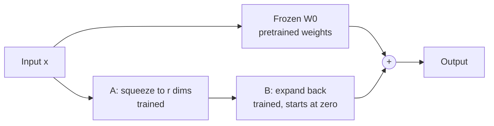

> [!abstract]
> Adapt a big pretrained language model to a task by learning a small add-on to its weights, leaving the original weights frozen.

## Overview

### Setting

Adapting one large pretrained language model to many separate tasks, such as answering questions over a database, summarising chats or classifying sentences. Success means matching full retraining while storing and training only a small change per task.

### Motivation

Full fine-tuning updates every weight, so each task needs its own complete copy of the model. At GPT-3 scale that is expensive in memory during training and in storage afterwards. The existing fixes each cost something:

- **Adapters** ([[Adapter layers]]) insert extra layers that run one after another with the model, so inference gets slower.
- **Prefix tuning** reserves part of the input for learned vectors. It is hard to optimise, and it uses up input length that the task needs.

The key insight is that the change needed for a new task is likely **low-rank**: it lives in a few directions, so a product of two small matrices can express it. This follows the [[Intrinsic dimension]] results of Aghajanyan et al.

### Method

For one weight matrix $W_0 \in \mathbb{R}^{d\times k}$ of the frozen model, the adapted layer computes

$$h = W_0 x + \frac{\alpha}{r} B A x, \qquad B \in \mathbb{R}^{d\times r},\; A \in \mathbb{R}^{r\times k},\; r \ll \min(d, k)$$

Here $x$ is the layer's input, $r$ is the rank, and $\alpha$ is a fixed scale. Only $A$ and $B$ are trained.

1. **Freeze** the pretrained weights $W_0$.
2. **Add** two thin matrices, $A$ that squeezes the input to $r$ numbers and $B$ that expands it back.
3. **Start** $A$ at random and $B$ at zero, so the model begins exactly as the pretrained one.
4. **Train** only $A$ and $B$ on the task.
5. **Merge** $BA$ into $W_0$ after training, so the deployed model has no extra layers.

The frozen path does what the pretrained model did; the thin path adds the task's change through a bottleneck of $r$ dimensions. After merging, the diagram collapses back to one matrix.

### Why it works

- **Frozen base, small update:** only the thin matrices are trained and stored per task, so memory and storage drop sharply while the big model is shared.
- **Zero start for B:** the first step changes nothing, so training begins from the pretrained model rather than from a disturbed one.
- **Merging after training:** the update folds into the original weights, so it adds no latency. This is the gap adapters leave open.
- **Scale by $\alpha/r$:** changing the rank does not force a retune of the learning rate.
- **Attention projections only:** the paper adapts the query and value projections and spreads a fixed budget over more matrices at lower rank, which works better than one matrix at high rank.

### Applications and results

| Domain | Task | Outcome |
|---|---|---|
| Language understanding | Sentence-pair and sentence classification (GLUE) | Matches or beats full fine-tuning with far fewer trained parameters |
| Dialogue and text generation | Restaurant-domain language generation (E2E) | Matches full fine-tuning and prefix methods |
| Text to SQL | Writing database queries from questions (WikiSQL) | Matches full fine-tuning |
| Summarisation | Chat summaries (SAMSum) | Matches full fine-tuning |
| Large model | The same tasks on GPT-3 175B | Matches or beats full fine-tuning; checkpoints shrink from hundreds of gigabytes to tens of megabytes |

### Evidence

- **Matched full fine-tuning:** across the benchmarks above, LoRA is at or near full fine-tuning, with the trained parameters reduced by orders of magnitude.
- **One team, mostly standard benchmarks:** the main tests use GPT-2, RoBERTa, DeBERTa and GPT-3, all from the same group.
- **Thin ablations:** the choice of matrices and rank is tested on one or two tasks. The paper itself warns that the low-rank result may not hold for a task far from pretraining, such as a new language.
- **Only attention is adapted:** the feed-forward layers, norms and biases stay frozen, and the paper leaves them to future work.
- **Batching limit:** merged weights serve one task at a time, so one batch cannot mix tasks.
- **Later checks (not from the paper):** newer studies find LoRA trails full fine-tuning on code and maths, see [[LoRA Learns Less and Forgets Less]].

### Novelty

- **vs [[Adapter layers]]:** the same bottleneck idea, but it runs beside the frozen weights and merges afterwards, so it adds no inference latency.
- **vs prefix tuning:** it uses no input length and is easier to optimise.
- **vs full fine-tuning:** the same quality on these tasks, but only the small matrices are stored per task.
- **vs [[Intrinsic dimension]] work:** it turns the observation into a concrete parameterisation that works on large models.
- **Broader trend:** follow-ups change which matrices are adapted or how the update is parameterised, such as [[QLoRA. Efficient Finetuning of Quantized LLMs|QLoRA]] and [[DoRA. Weight-Decomposed Low-Rank Adaptation|DoRA]].

### Concepts

- **[[Low-rank matrix factorization]]:** a matrix with rank $r$ can be written as $BA$ with inner size $r$, so the change has at most $r$ independent directions.
- **[[Intrinsic dimension]]:** the number of free parameters a task truly needs, which can be far below the model's size.
- **[[Adapter layers]]:** small extra layers inserted into a network, the main alternative LoRA is compared with.

## Questions

- Why would a task's weight change be low-rank at all?
- Why does starting $B$ at zero matter for the first training steps?
- Where does merging the weights stop being useful?
- Would one rank still suffice for learning a new language?

## Follow-ups

**Read**:
- [[Parameter-Efficient Transfer Learning for NLP]]: the adapter baseline LoRA improves on (not in library).
- [[LoRA Learns Less and Forgets Less]]: the later check on code and maths (not in library).
- [[QLoRA. Efficient Finetuning of Quantized LLMs|QLoRA]]: the same idea on a compressed base model (not in library).
- [[DoRA. Weight-Decomposed Low-Rank Adaptation|DoRA]]: splits the weight into size and direction before adapting (not in library).

**Try**:
- In a notebook, build one linear layer, add a rank-1 update $BA$ with $B$ at zero, and check the update's rank after a few gradient steps.
- Merge a trained update into the base weights and confirm the merged layer gives the same outputs as the layer with the separate path.
