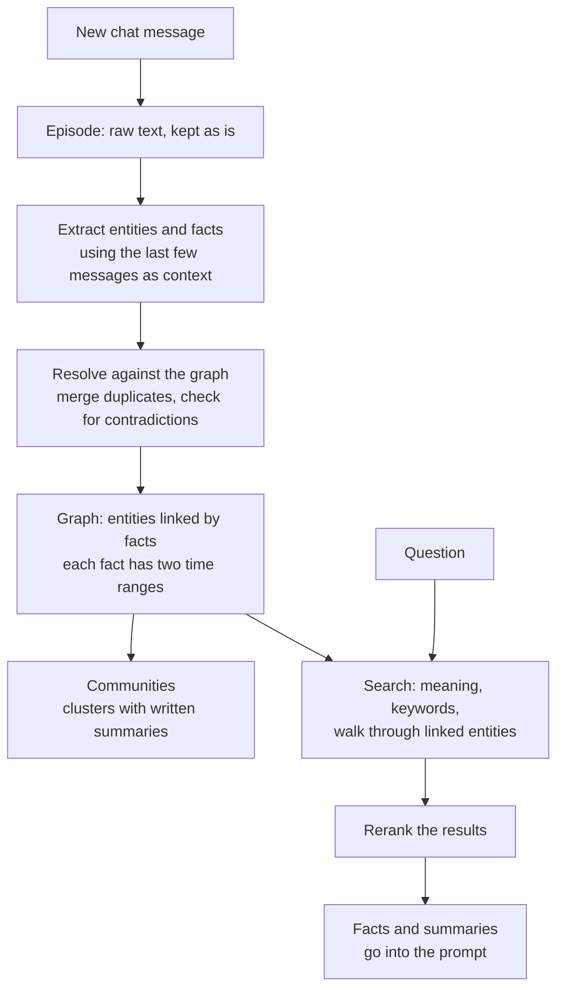

> [!abstract]
> Chat-agent memory as a graph of facts that remember when they were true and when the system learned them.

## Overview

### Setting

An assistant that talks with one person for months must recall what was said earlier and notice when it stops being true. "I moved to Berlin" should replace "I live in Paris", not sit next to it. Messages keep arriving, so the memory has to change as conversations happen rather than work from a fixed set of documents.

### Architecture

The raw messages stay in the store and the graph is built from them, so revising a fact never loses the message it came from.

### Recipe

The choices the paper says mattered:

- **Two clocks on every fact** ([[Bitemporal data]]): when it was true in the world, and when the system learned it. A changed fact closes the old one's end date instead of deleting it, so "where did I live last year?" still has an answer.
- **Contradiction check on write**: an LLM compares a new fact with related old ones. When they conflict, the newer one wins and the older one is marked as ended.
- **Hybrid search**: meaning-based search, keyword search and a graph walk run together, and a reranker orders the results.
- **Communities**: clusters of related entities with a summary, for broad questions. The paper picks a clustering method that can absorb one new node at a time, and rebuilds the clusters now and then because they drift.

### Results

| Benchmark | Task in plain words | Outcome |
|---|---|---|
| Deep Memory Retrieval | Recall a fact from short chats; the benchmark from [[MemGPT]] | Ties with feeding the whole conversation to the model |
| [[LongMemEval]] | Answer questions about long chats spread over many sessions | Beats the whole-conversation baseline with a much smaller prompt, so answers come back far faster |

Gains are largest on questions that span sessions or need time reasoning. A few question types got worse.

### Evidence

- **The authors built the system:** all numbers come from the team that sells Zep, and the baselines are their own.
- **Saturated benchmark:** on the older Deep Memory Retrieval test, a plain full-conversation baseline already scores as high, so it shows little. The authors say so themselves.
- **One long benchmark, one baseline:** LongMemEval is compared only against the full conversation. The authors could not get MemGPT to run on it.
- **Model-graded answers:** an LLM judge with the benchmark's own prompts scored the answers.
- **Untested part:** links from facts back to their source messages are described but not evaluated.

### Novelty

- vs [[MemGPT]]: memory is an external graph of timed facts, not text the agent pages in and out of its own context.
- vs [[GraphRAG]]: adds the raw episodes and time, and uses a clustering that updates as data arrives.
- vs [[HippoRAG]]: built from a live conversation rather than a fixed corpus, with time on every fact.
- vs [[AriGraph]]: the same split between raw episodes and entities, plus communities and time.

The paper calls the two-clock model a novel step for graphs built by LLMs; that is its own claim.

### Concepts

- **Knowledge graph**: entities as nodes and facts as labelled edges, so "Alice works at Acme" is one edge.
- **Bitemporal data**: each record carries two clocks, when it was true in the world and when the database recorded it.
- **Retrieval-augmented generation**: look up relevant text or facts and put them in the prompt before the model answers.

## Questions

- Why keep the old fact with an end date instead of deleting it?
- How is the end date chosen when a new fact contradicts an old one?
- What does the second clock buy that a single timestamp would not?
- Where would this break: facts that never change, or sources that disagree?
- Is the gain from time-aware facts, or from the graph structure?

## Follow-ups

**Read**:
- [[MemGPT]]: the agent-managed memory this paper benchmarks against, and the source of the first test.
- [[LongMemEval]]: the benchmark where the gains are shown; its question types structure the results.
- [[Mem0]]: a later production memory system with a graph variant that compares itself with Zep.
- [[HippoRAG]]: knowledge-graph memory over a fixed corpus, without time; the closest contrast.

**Try**: Run the Graphiti quickstart on a short chat, state a fact that contradicts an earlier one, and check which edge gets an end date.
