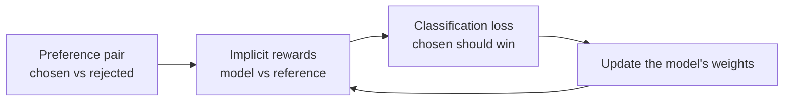

> [!abstract]
> Teach a language model human preferences with one classification loss on pairs of answers, with no separate reward model and no reinforcement learning.

## Overview

### Setting

A chatbot or summariser should give the answers people like, but it should still sound like the model it started from. People can compare two answers quickly ("this summary is better than that one"), but they cannot write down a score for every answer. The goal is to learn from those comparisons while staying close to a model that already works.

### Motivation

The standard recipe ([[InstructGPT]], [[Learning to summarize from human feedback]]) has three stages: train a model on demonstrations, train a **reward model** on the comparisons, then use reinforcement learning (usually PPO) to make the language model score high on that reward while a penalty keeps it near the starting model. That is three models and an unstable RL loop. The key insight of the paper: the best model under that penalised objective can be written in closed form, so the reward is already contained in the language model. The reward model is not needed as a separate object.

### Method

1. **Start** from a model already tuned on good examples; a frozen copy of it is the **reference**.
2. **Score** each answer in a preference pair by how much more likely the model makes it than the reference does, the **implicit reward**.
3. **Compare** the two implicit rewards and push the preferred one above the other, using a classification loss.
4. **Update** the model's weights; repeat over the dataset. No sampling from the model and no RL loop.

The paper's loss is

$$
\mathcal{L}_{\text{DPO}} = -\,\mathbb{E}\!\left[\log \sigma\!\left(\beta \log \frac{\pi_\theta(y_w \mid x)}{\pi_{\text{ref}}(y_w \mid x)} - \beta \log \frac{\pi_\theta(y_l \mid x)}{\pi_{\text{ref}}(y_l \mid x)}\right)\right]
$$

where $\pi_\theta$ is the model being trained, $\pi_{\text{ref}}$ the reference, $y_w$ the preferred answer and $y_l$ the rejected one for prompt $x$, $\sigma$ the logistic function, and $\beta$ how strongly the model is kept near the reference. Read it as: the loss is small when the model makes the preferred answer more likely, relative to the reference, than the rejected one.

The reference model appears only in the score, so the loop never needs a separate reward model. The arrows show that the model is its own reward signal.

### Why it works

- **The reference is the leash.** The implicit reward is a log-ratio against the reference, which is what the KL penalty of standard RLHF turns into. Answers the reference never liked do not get pushed up without limit.
- **The weight says how wrong the model is.** Each pair counts in proportion to how badly the implicit reward currently orders it. Pairs already ordered correctly change little. Without this weight, the paper's simpler "unlikelihood" baseline lowers both answers and the model degenerates.
- **Nothing is lost by the change of variables.** Preferences depend only on reward differences, so the unknown normalising term per prompt cancels. Any reward that fits the preferences has an equivalent form in terms of the model.
- **No RL means no instability.** The paper attributes PPO's trouble largely to the normalising term that DPO does not need.

### Applications and results

| Task | In everyday words | Outcome |
|---|---|---|
| Controlled review writing | Write positive movie reviews, with a classifier as the judge | Better trade-off between reward and drift from the start than PPO, even when PPO sees the true reward |
| Reddit summaries | Summarise a post in a few sentences | Preferred over human reference summaries more often than PPO's best setting, and steadier across sampling temperature |
| Helpful and harmless dialogue | Answer a single user question | Beats the dataset's chosen answers; matches a best-of-many sampling baseline |
| Out-of-distribution news | Summarise articles from a different source | Scores above PPO; humans prefer DPO's summaries to PPO's 58% of the time |

### Evidence

- **Real human labels, one task:** the summaries use human preference data; the dialogue data is human too.
- **Judged by a model:** most win rates use GPT-4 as judge. Its agreement with humans is about the same as humans agree with each other, but the win rate depends on the judge prompt.
- **Small models only:** the largest model is about 6B parameters.
- **Thin PPO baselines:** the PPO runs use an off-the-shelf library or light tuning, and there is no PPO run on dialogue.
- **Open questions left by the paper:** over-optimising against a learned reward and behaviour on unseen inputs.

### Novelty

- **vs [[Reinforcement learning from human feedback]] (PPO pipeline):** same objective, but the reward model and RL loop are replaced by one loss on the model itself.
- **vs the unlikelihood baseline:** the same push-down and push-up, weighted by how wrong the model is, which the paper shows is what stops collapse.
- **vs later variants** (not from the paper): [[IPO]] changes the loss to handle near-deterministic preferences, where DPO over-fits.

Since 2023 the field has moved toward reference-free variants and on-policy data (not from the paper).

### Concepts

- **[[Reward model]]**: a network trained to score answers so that preferred ones score higher.
- **[[Bradley-Terry model]]**: the assumption that the chance one answer wins is a sigmoid of the difference of their rewards, $P(y_w \succ y_l) = \sigma(r(y_w) - r(y_l))$.
- **[[KL-regularised objective]]**: maximise reward but stay close to a reference, measured by KL divergence.

## Questions

1. Which parameters change, and does the reference model ever get trained?
2. Why does the per-prompt normalising constant disappear from the loss?
3. What does a pair contribute once the model already ranks it correctly?
4. Where would this break: near-deterministic preferences, or answers far from the dataset?
5. How much of the win over PPO comes from the loss, and how much from the tuning of PPO?

## Follow-ups

**Read**:
- [[Learning to summarize from human feedback]]: the reward-model-plus-PPO pipeline DPO replaces, and the source of the summary preference data (not in library).
- [[InstructGPT]]: the standard RLHF recipe at scale (not in library).
- [[IPO]]: the closest variant, with an analysis of when DPO over-fits (not in library).
- Is DPO Superior to PPO for LLM Alignment?: a later, more tuned PPO comparison that challenges this paper's results (not in library).

**Try**:
- Pick one preference pair and compute the loss by hand with made-up log-probabilities. Watch the gradient weight shrink as the preferred answer's margin over the rejected one grows.
