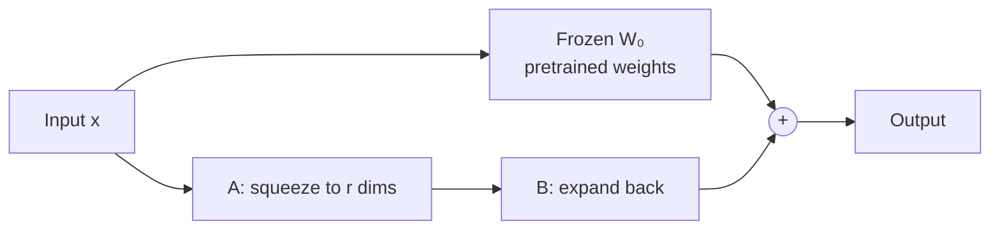

> [!abstract]
> Fine-tune a large model by training a small, separate correction that is folded back into the model afterwards, so one frozen base can serve many tasks.

## Overview

### Setting

Adapting one big pretrained language model to many tasks (summaries, SQL queries, classification). Full fine-tuning gives each task its own complete copy of the model, which is impractical when the model has billions of weights.

### Motivation

Earlier cheap methods either add extra layers that make inference slower ([[Parameter-Efficient Transfer Learning for NLP|adapters]]) or spend part of the input length on learned prompt vectors ([[Prefix tuning]]), and they often fell short of full fine-tuning. The paper builds on the observation that heavily over-parameterised models live on a low intrinsic dimension ([[Intrinsic dimension]]). Its bet: the change a fine-tune makes to a weight matrix is also low-rank, so it can be written with far fewer numbers.

**Key insight:** if the needed change is a few directions repeated, you do not need to store a full grid of new numbers to describe it.

### Method

1. **Freeze** the pretrained weight matrix $W_0$. Nothing in the base model is updated.
2. **Add** a correction $BA$ beside it, where $B$ and $A$ are thin matrices whose inner size is a small $r$.
3. **Start** with $B = 0$, so the model begins exactly at the pretrained behaviour, and train only $A$ and $B$.
4. **Merge** $W_0 + BA$ into one matrix when the task is done, so serving costs the same as the original model.

The frozen path is the old model; the thin side path learns the task. After training the side path is folded into the frozen matrix, so the diagram disappears at serving time.

### Why it works

- **Freeze the base** ([[Parameter-Efficient Transfer Learning for NLP]] named the same idea): the pretrained knowledge stays intact, and a task costs only the two thin matrices to store.
- **Zero-start B**: the first training step changes nothing, so the run begins from the strong pretrained model rather than a random perturbation of it.
- **Linear design, merged after training**: unlike adapters, the correction adds no extra layers, so there is no slower inference path.
- **Small rank**: the paper's bet is that the useful change needs only a few directions, so a tiny $r$ is enough (see the questions below).
- **Put the budget on attention**: the paper applies it to the query and value projections and spreads the parameter budget over more matrices rather than piling it onto one.

### Applications and results

| Domain | Task in everyday words | Outcome |
|---|---|---|
| Language understanding (GLUE) | Sentence-pair and classification tasks on RoBERTa and DeBERTa | Matched or beat full fine-tuning with far fewer trained weights |
| Text generation (E2E) | Restaurant descriptions from structured fields, on GPT-2 | Matched full fine-tuning |
| Large model (GPT-3 175B) | Text-to-SQL, entailment and summarisation | Matched full fine-tuning on all three; a per-task file shrinks from hundreds of gigabytes to tens of megabytes |

### Evidence

- **Standard benchmarks:** the tasks are classic academic sets close to what the models already do.
- **Thin ablations:** the choice of which matrices and which rank is tested on a couple of tasks only.
- **Limit, not tested here:** the update is applied to attention only, and merged weights cannot serve different tasks in one batch.
- **Later evidence (not from the paper):** on harder domains such as code and maths, LoRA trails full fine-tuning unless the rank is high ([[LoRA Learns Less and Forgets Less]]).

### Novelty

- **vs [[Parameter-Efficient Transfer Learning for NLP|adapters]]:** the same bottleneck idea, but applied as a side path that merges away, so it adds no inference latency.
- **vs [[Prefix tuning]]:** it does not use up the input length and is easier to optimise.
- **vs the intrinsic-dimension work:** that work measured the dimension of a whole model's training; this applies the low-dimension idea to each weight's change.

### Concepts

- **Low-rank matrix:** a grid built from a few independent directions. $BA$ with $B \in \mathbb{R}^{d \times r}$ and $A \in \mathbb{R}^{r \times k}$ has rank at most $r$, yet has $d \times k$ entries.
- **Intrinsic dimension:** the smallest number of free directions that still lets a model reach good solutions.

## Questions

- Why does zeroing $B$ at the start matter more than the random choice of $A$?
- If the true change were high-rank, what would a tiny $r$ lose, and would the loss show up in tasks far from pretraining?
- Why is the attention projection the right place to put the correction?
- What breaks if one server must answer many tasks in the same batch?

## Follow-ups

**Read:**
- [[QLoRA. Efficient Finetuning of Quantized LLMs]]: the same correction on a 4-bit frozen base, the usual way to run LoRA on a single GPU.
- [[DoRA. Weight-Decomposed Low-Rank Adaptation]]: splits each weight into size and direction and applies the low-rank update only to the direction.
- [[LoRA Learns Less and Forgets Less]]: the check on LoRA's claim of parity with full fine-tuning, on code and maths.

**Try:**
- Wrap one `nn.Linear` in a few lines of PyTorch with a frozen weight and two thin matrices, and confirm the output is unchanged at initialisation.
