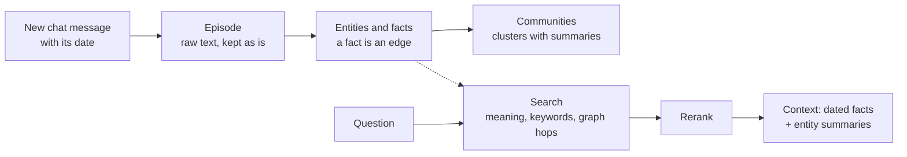

> [!abstract]
> Chat-agent memory as a graph of facts, each dated by when it was true and when the system learned it.

## Overview

### Setting

Long-running assistants have to remember what a user said weeks ago, and notice when a preference or a job has changed. The whole history is too long to paste into every prompt, and a plain search over old chats returns the old answer alongside the new one.

### Architecture

The memory is a graph with three layers. Raw messages sit at the bottom and are never discarded; the facts pulled out of them sit above; clusters of related entities with written summaries sit on top.

Because every fact keeps a pointer to the message it came from, an answer can always be traced back to what was actually said. Reading the diagram from the question side: the answer is built from whichever facts and entities the search surfaces, not from the whole graph.

### Recipe

- **Fixed database writes.** The system writes the graph with predefined queries, not with queries the model writes, to keep the schema consistent and avoid malformed writes.
- **Facts are compared only within an entity pair.** A new fact is checked for duplicates only against facts between the same two entities, which keeps each check small.
- **Contradictions close old facts.** An LLM checks a new fact against related ones; if it contradicts one, the old fact gets an end date instead of being deleted.
- **Communities updated in place.** A new entity joins the community most of its neighbours belong to, and the communities are rebuilt from scratch now and then, because they drift.

### Results

| Benchmark | What it tests | Outcome |
|---|---|---|
| Deep Memory Retrieval | short chats, one-fact questions | Zep ties the full-history prompt and the MemGPT number, near the ceiling. The authors call the benchmark too easy. |
| LongMemEval | histories of about 115k tokens, several kinds of question | More accurate than putting the whole history in the prompt, with about a tenth of the latency and a context of about 1.6k tokens. |

On LongMemEval the gains are largest on preference, temporal and multi-session questions. The one clear loss is on questions about what the assistant itself said earlier.

### Novelty

- **vs [[MemGPT]]:** the model pages its own memory in and out with function calls. Zep keeps an external graph and searches it, so the model never manages storage.
- **vs [[GraphRAG]]:** GraphRAG builds its graph from a fixed document set. Zep builds from a stream of messages and keeps each message as an episode.
- **vs [[HippoRAG]]:** HippoRAG has no notion of time. Zep's facts carry validity dates and are closed when they are contradicted.
- **Time as a second axis:** the paper's main claim is that a fact should record both when it held in the world and when the system learned it. The authors call this a new step for LLM knowledge graphs.

### Evidence

- **Vendor-run:** the authors ran Zep on their own hosted service and built the evaluation themselves.
- **Missing comparisons:** MemGPT could not be run on LongMemEval, and no other memory system is compared on it.
- **Thin ablations:** no run switches off the temporal edges or any reranker, so the paper does not show which part earns the gain.
- **One judge:** answers are scored by an LLM judge using the benchmark's own prompts.
- **Later tests (not from the paper):** independent evaluations collected in the library's memory review show mixed results for Zep, so read the numbers as the authors' own.

### Concepts

- [[Temporal knowledge graph]]: a graph whose edges are facts that can start and stop.
- [[Bitemporal data]]: two clocks per fact: when it was true, and when the database learned it.
- [[Episodic and semantic memory]]: episodic memory holds events; semantic memory holds what they mean.
- [[Label propagation]]: each node takes the most common label among its neighbours, which makes it easy to add nodes one at a time.

## Questions

- What exactly gets changed when a contradicting fact arrives?
- Why keep both timelines instead of overwriting the old fact?
- When would keeping the whole history in the prompt beat a graph?
- Why must the database writes be fixed rather than written by the model?

## Follow-ups

**Read**

- [[GraphRAG]]: the source of the community summaries Zep borrows.
- [[MemGPT]]: the baseline on the short-chat benchmark, and the agent-managed alternative.
- [[HippoRAG]]: a graph memory over a fixed corpus, useful for contrast.
- [[LongMemEval]]: the benchmark whose question types structure the results.

**Try**

- Write a three-message chat in which a person changes jobs. Write the fact edges by hand with their validity dates, and see which one gets an end date when the new job arrives.
